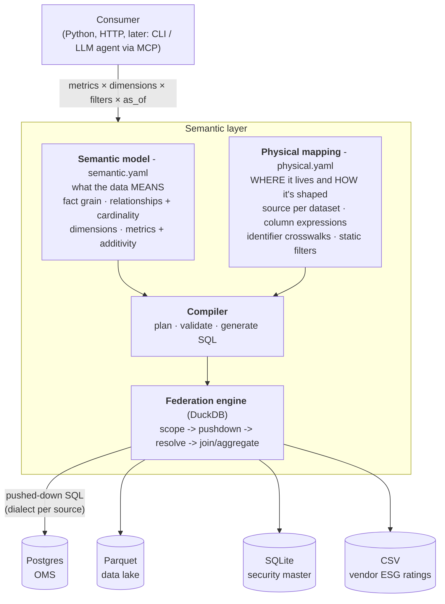
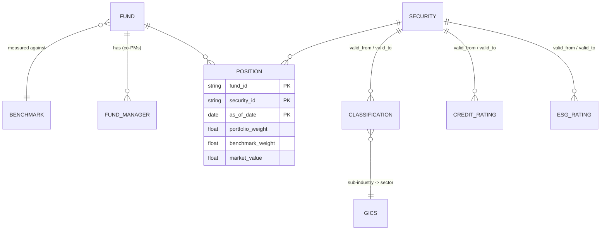
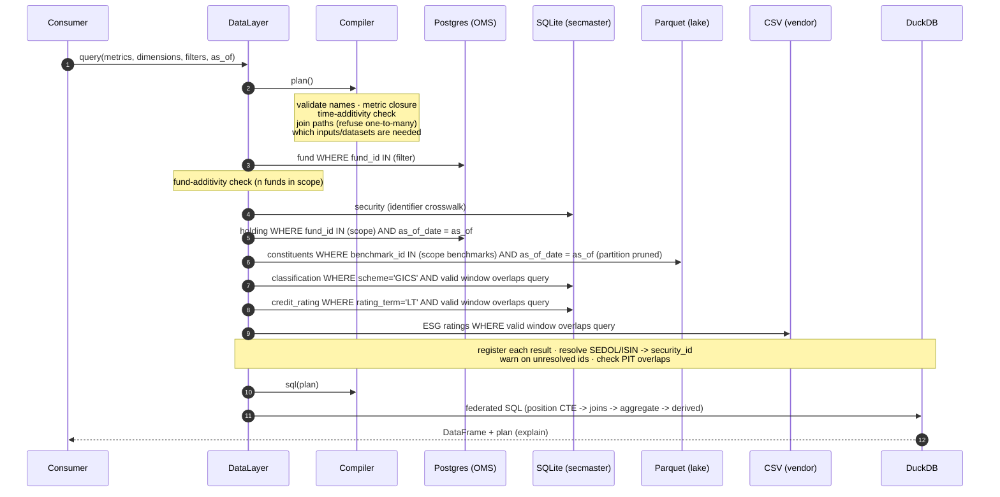

# Design: a semantic layer over federated asset-management data

**Status:** MVP implemented · **Scope:** example / reference implementation · **Last updated:** 2026-10-24

---

## 1. Summary

Investment data is spread across systems that were never designed to agree with each other. Positions sit in the OMS, benchmark constituents in a data lake, instrument reference data and credit ratings in a security master, and ESG ratings in vendor file drops. Each uses its own identifiers, units and date conventions.

This repo builds a **semantic layer**: one interface where a consumer asks for *metrics* (active weight, active share, weighted credit or ESG score) by *dimensions* (fund, sector, credit rating, date). The consumer never knows which store answers the question. The layer:

- turns the request into per-source queries, with filters pushed down into each store;
- resolves identifiers across sources;
- joins slowly-changing attributes point-in-time;
- combines portfolio and benchmark data correctly;
- **refuses queries that would silently produce wrong numbers.**

The main design choice is that consumers do **not** write joins and group-bys over a logical schema. They ask for metrics and dimensions, and the layer owns join paths, cardinality and aggregation rules. In this domain, most wrong numbers come from consumers getting exactly those things wrong.

---

## 2. Problem

### 2.1 What it looks like today

| Question a PM or analyst asks | What they actually have to know |
|---|---|
| "What's my sector active weight vs benchmark?" | The OMS stores weights in **percent** and keys by **SEDOL**. The lake stores benchmark weights as **fractions**, keyed by **ISIN** and by **benchmark**, not fund. Sector lives in the security master, with its own date-range table. |
| "How did the ESG tilt change over the quarter?" | ESG ratings come in a vendor CSV with `YYYYMMDD` dates and blank end dates. You need the rating *valid on each month-end*, not today's. |
| "What are my biggest over- and underweights?" | You must include benchmark names you **don't hold**, or every underweight disappears. |

Each team rebuilds this logic in SQL, Python or Excel, and the results differ.

### 2.2 Why "a virtual database with nicer table names" isn't enough

A federated SQL engine with views (Trino, Denodo, a data virtualisation layer) solves *location*: you no longer need to know where the data lives. It doesn't solve *meaning*. Users still write joins, so they still:

- inner-join holdings to the benchmark and lose underweights;
- join ratings history without a point-in-time condition and double count;
- sum weights across funds or dates, which gives a number with no meaning;
- join to a one-to-many table (co-PMs) and inflate everything.

These produce **plausible but wrong numbers**, which is worse than an error. So the interface has to sit one level higher: metrics and dimensions, with the rules encoded once.

---

## 3. Goals and non-goals

**Goals (MVP)**

1. One query interface (Python + HTTP) expressed only in business terms.
2. Data genuinely split across four stores of different types: Postgres, Parquet, SQLite and CSV.
3. Domain correctness by construction: full-outer portfolio/benchmark combination, point-in-time attributes, additivity rules and fan-out protection.
4. Transparency: every result carries an `explain()` plan showing the exact per-source queries and the federated SQL.
5. Runs with one command (`make up`) and is small enough to read in an afternoon.

**Non-goals (for now)**

- Production scale, caching or materialisation.
- Entitlements and row-level security (design hook noted in §11).
- Multi-currency (all market values are in USD).
- Fund-of-funds look-through, derivatives exposure and cash modelling.
- CLI and MCP server (next phase, §12).

---

## 4. Mental model




There are two models, kept deliberately separate:

| | Semantic model | Physical mapping |
|---|---|---|
| Owned by | Domain / data product owner | Platform / data engineering |
| Changes when | The business definition changes ("active share should exclude cash") | A system changes (OMS migration, new vendor) |
| Mentions | Entities, metrics, grain, cardinality | Tables, columns, units, ID schemes, dialects |
| Consumer visible | Yes, via `/catalog` | Never |

Moving holdings from Postgres to Snowflake should change one block of `physical.yaml` and no consumer code. Redefining active share should change one block of `semantic.yaml` and no pipelines.

---

## 5. Domain model

### 5.1 Logical entities



### 5.2 Glossary

| Concept | Definition in this model |
|---|---|
| **Fund** | A portfolio with a base currency, a strategy and exactly one benchmark. |
| **Benchmark** | An index. Its constituents and weights are published per date. |
| **Holding** | A fund's position in a security on a date (OMS view). |
| **Constituent** | A security's weight in a benchmark on a date (index view). |
| **Position** | The *conformed fact*: (fund, security, date) carrying **both** portfolio and benchmark weight. A row exists if either side is non-zero. |
| **Active weight** | `portfolio_weight − benchmark_weight`. Negative means underweight. |
| **Active share** | `½ · Σ |active weight|` over securities. 0 is index-like; 1 means no overlap. |
| **Classification** | GICS hierarchy (sector → industry group → industry → sub-industry), **point-in-time**. |
| **Rating** | Issuer long-term **credit** rating, AAA..D, mapped to a 22..1 score (one point per notch) and to investment grade (BBB- and above) / high yield. **Point-in-time.** This is what "rating" means unqualified. |
| **ESG rating** | Vendor ESG rating AAA..CCC, mapped to a 7..1 score, **point-in-time**. A different scale that uses similar letters, so it is always named `esg_*`. |

### 5.3 Why one conformed fact

The key modelling decision is the **position** fact at grain `(fund, security, as_of_date)`, built from two sources:

```
holding                (fund, security, date, pw, mv)         -- from OMS
benchmark_constituent  (benchmark, security, date, bw)        -- from lake
   └── bridged to fund via fund.benchmark_id                  -- one benchmark -> many funds
```

These are combined as `UNION ALL` and then `GROUP BY grain`, which is a full outer join. It also generalises to N inputs, for example a model portfolio or a target allocation later. Every metric is then defined over one fact at one grain, and every dimension joins *outward* from that grain via many-to-one edges. That arrangement makes fan-out structurally impossible, rather than something each query has to get right.


---

## 6. The physical estate

The seed generator (`src/semlayer/seed.py`) builds a fictional but realistic estate. Tables and columns use plain names, often the same as the logical ones, so `physical.yaml` only maps what actually differs. The differences that remain are the ones real sources have, and each is something the layer has to absorb.

| Store | Tech | Tables / files | Keyed by | Conventions to absorb |
|---|---|---|---|---|
| OMS | Postgres (own container) | `fund`, `fund_manager`, `holding` | Fund code, **SEDOL** | Weights in **percent**, NUMERIC types |
| Data lake | Parquet, hive-partitioned `as_of_date=YYYY-MM-DD/` | `benchmark.parquet`, `benchmark_constituents/` | Benchmark id, **ISIN** | Weights as **fractions**; keyed by benchmark, not fund |
| Security master | SQLite | `security`, `classification`, `gics`, `credit_rating` | Canonical **security_id** + crosswalk | Dates as **text**, `NULL` = open-ended, **two schemes** (GICS + ICB) in one table, **long- and short-term** credit ratings in one table |
| Vendor feed | CSV | `esg_ratings.csv` (ESG only) | **ISIN** | Dates as `YYYYMMDD`, blank end date = current |

**Planted scenarios** (each has a test):

- `S0001` is reclassified IT → Communication Services on 2026-08-15.
- `S0002`'s ESG rating is downgraded AA → BB on 2026-08-20.
- `S0003`'s credit rating is cut BBB- → BB+ on 2026-09-10: a fallen angel, investment grade to high yield.
- `UK_EQ` holds an off-benchmark US stock, plus, on 2026-09-30, a new listing whose SEDOL isn't in the security master yet.
- `GLB_EQ` has two co-PMs (the one-to-many trap).
- Some securities have no credit rating, and some have no ESG rating (coverage < 100%).

---

## 7. Semantic model in detail

All of this lives in [`model/semantic.yaml`](../model/semantic.yaml).

### 7.1 Relationships and cardinality

The compiler finds join paths by breadth-first search from the fact over declared relationships. **Every edge on a path must be `many_to_one`**, otherwise the query is refused.

```yaml
- {from: position.security_id, to: security.security_id, cardinality: many_to_one}
- from: position.security_id
  to: credit_rating.security_id
  cardinality: many_to_one
  point_in_time: {at: position.as_of_date, valid_from: valid_from, valid_to: valid_to}
- {from: fund.fund_id, to: fund_manager.fund_id, cardinality: one_to_many}   # declared so it can be refused
```

A ratings *history* table is one-to-many on `security_id`. The point-in-time condition (`valid_from <= as_of_date < valid_to`, half-open) is what makes the edge many-to-one. That only holds if the intervals don't overlap, so the engine **checks for overlaps at runtime** and warns if any exist.

### 7.2 Dimensions

Dimensions use business names (`security.sector`), not dataset names (`gics.sector_name`). One entity namespace can draw from several datasets: `security.sector` comes from `gics` via `classification`, `security.rating` from the security master's credit ratings, and `security.esg_rating` from the vendor feed. Business rules such as the rating-to-score mapping are dimension expressions in the semantic model, not in the vendor mapping.

`identifies: true` marks dimensions that uniquely identify their entity. That matters for additivity: grouping by `fund.strategy` still sums across funds.

### 7.3 Metrics

| Kind | Example | Evaluated |
|---|---|---|
| `simple` | `portfolio_weight: sum({portfolio_weight})` | Aggregate over position rows |
| `simple` with row expression | `active_share: sum(0.5*abs({portfolio_weight}-{benchmark_weight}))` | Per security row, *then* summed. Correct at any grouping, and decomposes by sector. |
| `ratio` | `portfolio_rating_score: sum(pw*score) / sum(pw where rated)` | Numerator and denominator aggregated separately, divided last. Never averages averages. |
| `derived` | `active_weight: portfolio_weight - benchmark_weight` | After aggregation, from other metrics (can nest) |

### 7.4 Additivity

Each metric declares the axes it is **non-additive** over:

| Metric | `time` | `fund` | Why |
|---|---|---|---|
| `market_value` | ✗ | ✓ | A stock, not a flow. Summing across funds is fine (single currency). |
| weights, active share, rating scores | ✗ | ✗ | Relative to each fund's NAV on each date. |
| `holding_count` | ✓ | ✓ | Count-distinct is computed correctly at any grain. |

The rules:

- **Time:** if a date range spans more than one date and `time.as_of_date` isn't a dimension, the query is refused.
- **Fund:** if more than one fund is in scope and no fund-*identifying* dimension is selected, the query is refused. This check runs after the scope is resolved, so filtering to a single fund lets you drop the fund dimension.

---

## 8. Query lifecycle




**Pushdown strategy.** The fund dataset is the *scope*. It's small, so it's loaded first with fund filters applied at the source. Its keys are then pushed into the large fact sources: `fund_id` into the OMS, and the *derived* benchmark ids into the lake. This is a semi-join reduction, the same idea as Trino's dynamic filtering. Dates are pushed into fact sources, and validity windows into point-in-time sources. Other filters are applied in DuckDB.

### 8.1 Worked example

```python
dl.query(
    metrics=["portfolio_weight", "benchmark_weight", "active_weight"],
    dimensions=["fund.code", "security.sector"],
    filters={"fund.code": "GLB_EQ"},
    as_of="2026-09-30",
)
```

What gets sent to the lake. Only one benchmark and one partition are read:

```sql
SELECT "benchmark_id", "isin", "as_of_date", "benchmark_weight"
FROM read_parquet('/data/lake/benchmark_constituents/*/*.parquet', hive_partitioning = true)
WHERE "benchmark_id" IN (?) AND "as_of_date" = ?        -- ['IDX_GLB_ALL', 2026-09-30]
```

What runs in DuckDB (abridged):

```sql
WITH "position" AS (                    -- conformed fact: full outer via UNION ALL + GROUP BY
  SELECT fund_id, security_id, as_of_date, SUM(portfolio_weight) ..., SUM(benchmark_weight) ...
  FROM (
    SELECT i.fund_id, i.security_id, i.as_of_date, i.portfolio_weight, i.market_value, 0.0 AS benchmark_weight
    FROM ds_holding i
    UNION ALL
    SELECT fund.fund_id, i.security_id, i.as_of_date, 0.0, 0.0, i.benchmark_weight
    FROM ds_benchmark_constituent i JOIN ds_fund fund ON i.benchmark_id = fund.benchmark_id   -- bridge
  ) u GROUP BY fund_id, security_id, as_of_date
),
agg AS (
  SELECT fund.fund_code AS "fund.code", gics.sector_name AS "security.sector",
         SUM(position.portfolio_weight) AS portfolio_weight, SUM(position.benchmark_weight) AS benchmark_weight
  FROM position
  LEFT JOIN ds_fund fund ON position.fund_id = fund.fund_id
  LEFT JOIN ds_classification classification
    ON position.security_id = classification.security_id
   AND classification.valid_from <= position.as_of_date AND position.as_of_date < classification.valid_to
  LEFT JOIN ds_gics gics ON classification.sub_industry_code = gics.sub_industry_code
  WHERE fund.fund_code IN (?)
  GROUP BY ALL
)
SELECT "fund.code", "security.sector", portfolio_weight, benchmark_weight,
       (portfolio_weight - benchmark_weight) AS active_weight
FROM agg ORDER BY 1, 2
```

`ds_holding` is a view that has already converted percent to fractions and mapped SEDOL to `security_id`. The federated SQL only ever sees logical names.

---

## 9. Correctness rules

These are the reason the layer exists. Each is enforced in code and covered by tests.

| # | Pitfall | Consequence if ignored | How it's prevented | Test |
|---|---|---|---|---|
| 1 | Inner join of holdings to benchmark | Underweights vanish; active weights don't net to zero | Conformed fact = full outer combination | `test_benchmark_only_names_are_underweights` |
| 2 | Joining SCD history without an as-of condition | Double counting; today's sector applied to last quarter | Point-in-time edges, half-open intervals, overlap check | `test_point_in_time.py` |
| 3 | Summing weights across funds | Meaningless "300%" totals | `non_additive: [fund]` + identifying-dimension check | `test_weights_cannot_be_summed_across_funds` |
| 4 | Summing stocks across dates | MV of a quarter = 4× MV | `non_additive: [time]` | `test_stocks_cannot_be_summed_across_dates` |
| 5 | Joining a one-to-many attribute (co-PMs) | Every weight duplicated | Only many-to-one paths are joinable | `test_one_to_many_dimension_is_refused` |
| 6 | Identifier mismatch (SEDOL vs ISIN) | Rows silently dropped by joins | Crosswalk at the physical edge; unresolved ids **kept** in totals and **reported** | `test_unresolved_identifiers_are_reported_not_dropped` |
| 7 | Mixed content in one table (GICS + ICB, long- + short-term credit ratings) | Fan-out; wrong scale | Static `where` in the physical mapping | `test_other_classification_schemes_are_excluded`, `test_short_term_credit_ratings_are_excluded` |
| 8 | Averaging averages | Wrong weighted scores at sector level | Ratio metrics aggregate numerator and denominator separately | (by construction) |
| 9 | Unit mismatch (percent vs fraction) | Weights off by 100× | Normalised in the physical column expression | `test_weights_sum_to_one_and_active_nets_to_zero` |
| 10 | Same word, different scale (credit vs ESG "rating", both AAA-style letters) | ESG scores reported as credit quality | Unqualified `rating` is always credit; ESG is always `esg_*` | `test_credit_and_esg_ratings_are_separate` |

The policy is **refuse rather than warn** for anything that would make the number wrong (1–5), and **warn but keep** for data-quality issues where the number is still the best available (6, PIT overlaps).

---

## 10. Interface

### Python

```python
from semlayer import DataLayer

dl = DataLayer.from_env()          # reads model/ + OMS_DSN, DATA_DIR
dl.catalog()                       # entities, dimensions, metrics - no physical detail

res = dl.query(
    metrics=["active_weight", "active_rating_score"],
    dimensions=["fund.code", "security.region"],
    filters={"fund.code": ["GLB_EQ", "GLB_SUS"]},
    as_of="2026-09-30",
    order_by=["-active_weight"],
)
res.df              # pandas DataFrame
res.plan.warnings   # data-quality warnings
print(res.explain())  # per-source SQL + federated SQL
```

### HTTP (FastAPI, OpenAPI docs at `/docs`)

| Method | Path | Body |
|---|---|---|
| GET | `/catalog` | none |
| POST | `/query` | `{metrics, dimensions, filters, as_of \| date_range, order_by, limit, explain}` |

Both endpoints are read-only. `/query` is a POST only because its body (lists of metrics and dimensions, nested filters) doesn't fit comfortably in a URL.

`QueryError` maps to HTTP 400 with the explanation, e.g. *"portfolio_weight cannot be aggregated across funds (3 funds in scope). Add 'fund.code' to dimensions or filter to a single fund."* These messages are written to be actionable by a human **or an LLM agent**.

---

## 11. Key decisions

**D1 – Metrics and dimensions, not a logical SQL schema.** *Gain:* correctness rules live in one place; the consumer surface is small and easy to discover. *Give up:* arbitrary ad-hoc SQL. *Alternative:* expose the federated views directly for power users as an escape hatch, clearly labelled "you own the joins".

**D2 – Custom thin compiler rather than Cube / dbt MetricFlow / Malloy.** This is a reference implementation, and the goal is to make the mechanism visible: about 1,100 lines of core code (compiler, connectors, engine, API) you can read in one sitting. In production I'd evaluate those tools first. The concepts map directly (§13), and most of this repo's value transfers as *model design*, not code.

**D3 – DuckDB as the federation engine.** It runs in-process, needs no cluster, and reads Parquet and CSV natively. *Give up:* distributed execution. At larger scale, swap in Trino/Starburst behind the same compiler; the generated SQL is close to ANSI already.

**D4 – Explicit Python connectors instead of DuckDB's `postgres_scanner` / `sqlite_scanner`.** The pushed-down query is a visible, testable artefact (`explain()` shows the exact SQL sent to each store), and nothing needs downloading at runtime, which matters in locked-down environments. *Give up:* the scanners' automatic projection and filter pushdown, and streaming. This is the first thing to revisit for performance.

**D5 – `UNION ALL` + `GROUP BY` instead of `FULL OUTER JOIN`.** Same result for two inputs. It extends to N inputs (model portfolio, target, previous date) without growing a tree of `COALESCE`s, and grain columns never need coalescing.

**D6 – Two YAML files.** They have different owners and change for different reasons (§4). Both are validated together at startup (`model.validate`), so a broken mapping fails at deploy time, not at query time.

**D7 – Refuse, don't guess.** A refused query costs a user seconds. A wrong active weight in a client report costs far more.

**D8 – One way to ask: `/catalog` and `/query` only.** The interface is read-only, with one request shape that people, scripts and agents learn once, and every rule applies everywhere. *Give up:* named shortcuts for common questions (e.g. "positions more than 3% off benchmark"). If those matter, they belong in a client (CLI, MCP tool) as saved queries, not as new server endpoints.

---

## 12. Failure modes and operational concerns

| Concern | Current behaviour | Production answer |
|---|---|---|
| **Data volume** | Each source result is pulled into memory | Scanner-based pushdown, aggregation pushdown to sources, or materialised daily position snapshots |
| **Cross-source timing** | OMS and lake may be at different load states for a date | Publish "data complete for date X" markers per source; refuse or flag dates not complete everywhere |
| **Source outage** | Query fails with the source error | Per-source timeouts, partial-result policy (probably *fail*: half a portfolio is a wrong portfolio) |
| **Identifier drift** | Unresolved ids kept, reported in warnings | Feed warnings into DQ monitoring; alert on unresolved weight > threshold |
| **SCD interval overlaps** | Detected at query time → warning | Enforce at ingestion with a constraint or test in the source pipeline |
| **Model change safety** | Startup validation | CI: validate models + golden-query regression tests on every change |
| **Entitlements** | None | Scope dataset is the natural hook: inject entitled `fund_id`s into the scope filter, so access control is pushed down to every source for free |
| **Observability** | `explain()` plan with per-source timings and row counts | Emit the plan as an OpenTelemetry span per source query; log metric/dimension usage to see what consumers rely on |
| **Performance hot spots** | Security master loaded in full for crosswalks | Cache reference data with TTL; push security-id semi-joins |

### Known limitations of the MVP

- Filters are equality / `IN` only. Only fund and date filters are pushed to sources; others are applied in DuckDB.
- The scope entity is fixed (fund). A query with no fund dimension still loads all funds, which is fine at this scale.
- `holding_count` counts *resolved* securities. A holding with an unknown SEDOL contributes weight but not a count.
- Single currency (USD), a single credit rating agency (no composite of several agencies) and a single ESG vendor.

---

## 13. Mapping to industry tools

| Concept here | Cube | dbt MetricFlow | Trino / Starburst |
|---|---|---|---|
| `semantic.yaml` entities + dimensions | `cubes` / `views`, `dimensions` | `semantic_models`, `entities`, `dimensions` | - |
| Relationships + cardinality | `joins` with `relationship` | `entities` (primary/foreign) | - |
| Metrics (simple / ratio / derived) | `measures` | `metrics` (simple, ratio, derived) | - |
| `non_additive` | not built in (custom SQL) | `non_additive_dimension` | - |
| Point-in-time joins | custom SQL | SCD type 2 `validity_params` | - |
| `physical.yaml` + connectors | data source drivers | warehouse adapters | catalogs + connectors |
| Federation (DuckDB) | single warehouse per cube | single warehouse | **this is Trino's core job** |
| Scope semi-join pushdown | - | - | dynamic filtering |

A realistic production shape is **MetricFlow or Cube for the semantic model, over Trino for federation**, or over a warehouse if the data can be landed in one place. One point argues against federation altogether: if all the data can be landed nightly in one warehouse, do that, keep the semantic layer, and drop the federation complexity.

---

## 14. Roadmap

| Phase | Item | Why |
|---|---|---|
| **Next** | CLI (`semlayer query --metrics ... --by ...`) | Fast human exploration, scripting |
| **Next** | **MCP server** exposing `catalog`, `query`, `explain` | Agents choose metrics and dimensions from a closed vocabulary instead of writing SQL. The guard-rail errors become self-correcting feedback. |
| Then | Entitlements via scope injection | Required before real data |
| Then | Golden-query regression suite in CI | Safe model evolution |
| Then | Multi-currency (FX as a point-in-time dataset) | Cross-fund MV in any reporting currency |
| Then | Contribution / attribution metrics (e.g. active weight × return) | The next question after "where am I over- and underweight" |
| Later | Look-through, derivatives exposure, cash | Real-world portfolio completeness |
| Later | Filtering on metric values (e.g. only positions ≥ 3% off benchmark) | Common for exploration, but kept out of the MVP to keep `query` simple |
| Later | Swap DuckDB connectors for scanners/Trino | Scale |

---

## 15. Extending the model

**Add a metric.** Add it to `semantic.yaml`, e.g. a weighted average market cap once a `market_cap` dimension exists:

```yaml
portfolio_avg_cap:
  description: Holding-weighted average market cap.
  ratio:
    numerator: "{portfolio_weight} * {security.market_cap}"
    denominator: "CASE WHEN {security.market_cap} IS NOT NULL THEN {portfolio_weight} END"
  non_additive: [time, fund]
```

**Add a dimension from a new source.** (1) Add a `source` and a `dataset` to `physical.yaml`, with an `identifiers` crosswalk if it doesn't key by `security_id`. (2) Add a `relationship` from the fact (or from an existing dataset) in `semantic.yaml`, with `point_in_time` if it's time-varying. (3) Add the dimension under its business entity. No compiler changes are needed.

**Move a dataset to another store.** Change its `source`, `table` and `columns` expressions in `physical.yaml`. Nothing in `semantic.yaml` or any consumer changes.

---

## 16. Repo map

```
model/semantic.yaml        what the data means (consumer contract)
model/physical.yaml        where it lives (platform contract)
src/semlayer/model.py      YAML -> dataclasses, cross-model validation
src/semlayer/compiler.py   planning, correctness rules, SQL generation
src/semlayer/connectors.py per-store dialects + pushdown (Postgres, SQLite, Parquet, CSV)
src/semlayer/engine.py     DataLayer: scope -> pushdown -> resolve -> federate; explain
src/semlayer/api.py        FastAPI
src/semlayer/seed.py       synthetic estate with planted edge cases
examples/walkthrough.py    guided tour (make demo)
tests/                     one test per correctness rule
```
